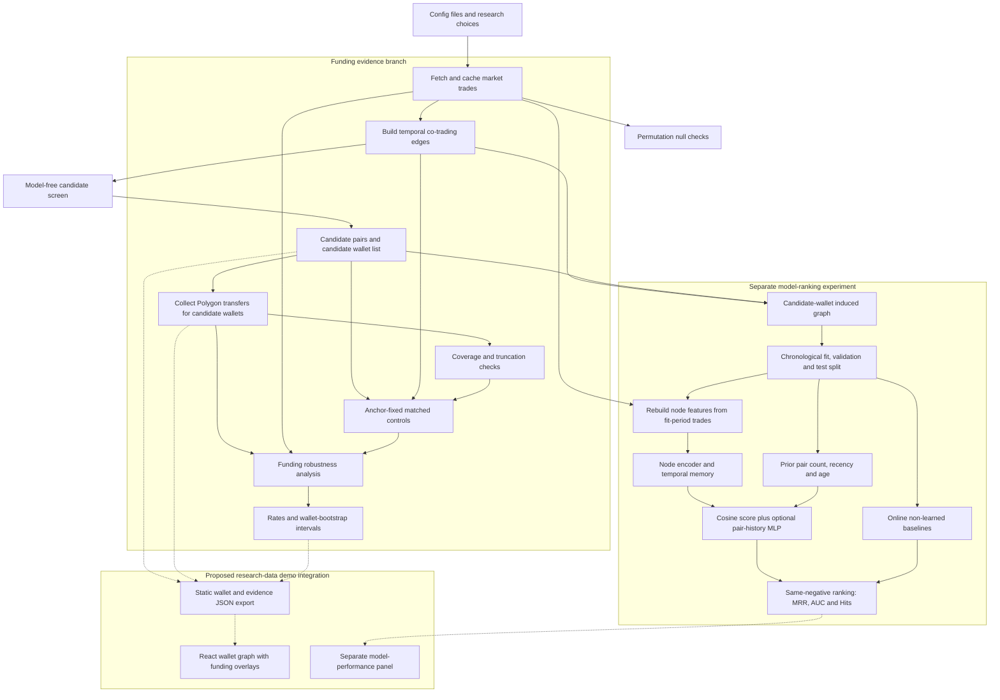

# Polymap research report

**Project:** Polymarket lockstep-wallet discovery and on-chain funding validation  
**Markets:** Xi (`xi_2027_63d_p50`) and Iran (`rep_iran`)  
**Status:** exploratory capstone result; not evidence of ownership, intent, or coordination  
**Report date:** 2026-10-26

## Contents

1. [Executive summary](#1-executive-summary)
2. [Overall structure and flowchart](#2-overall-structure)
3. [Component and CLI guide](#3-component-guide)
4. [Data, candidate rules and null results](#4-data-and-candidate-construction)
5. [Funding results and sensitivity analyses](#5-funding-validation-design)
6. [Model architecture, validation and five-seed results](#6-model-ranking-experiment)
7. [Wallet-graph visualization](#7-visualization-plan)
8. [Limitations](#8-limitations-and-threats-to-validity)
9. [Artifacts, commands and verification](#9-reproducibility-and-artifact-index)
10. [Conclusion](#10-final-conclusion)

## 1. Executive summary

Polymap asks whether wallets screened for close co-trading show observable
Polygon funding links more often than comparable wallet pairs. The project has
two distinct analytical parts:

1. A **model-free lockstep screen** creates candidate wallet pairs from close
   trading times and prices, recording persistence and same-side behavior.
2. A separate **funding-robustness analysis** compares those candidates with
   anchor-fixed, co-timing-matched controls.

The custom memory-based temporal model is a third, separate experiment. It
learns to rank future co-trading links on a chronological held-out split. It is
not part of the funding-evidence chain and does not create the candidate pairs
used in the funding analysis.

### Main findings

- Direct-transfer rates were higher for candidate pairs in both markets.
- The pre-agreed primary success criterion was **not met in either market**:
  both all-wallet 95% intervals included zero.
- The direction persisted in the truncated-wallet sensitivity analyses, where
  the intervals excluded zero by very small margins.
- Shared-funder evidence did not replicate under the broad any-transfer
  definition.
- The fixed tuned configuration achieved higher mean MRR than the plain
  configuration in both markets. It beat recency on Xi; its Iran mean was
  slightly below recency. This is not a statistical equivalence result.
- The overall result is **suggestive, not confirmed**.

The approved interpretation is “lockstep pair” and “funding link observed.”
This report does not use those observations to claim that wallets have the same
owner or are coordinating.

**Evidence basis:** numerical tables below come from the saved CSV/JSON files
unless explicitly marked as historical notes. Xi's original all-wallet funding
CSV was overwritten; its rounded results are retained in
`docs/funding_validation_findings.md`. Earlier sandbox tuning claims are
identified separately from results reproduced in this workspace. This report
consolidates the current two-market study; older small-slice experiments are
historical context, not additional replications.

## 2. Overall structure



The key separation is:

> `candidates` creates the funding-analysis sample. `train` evaluates a
> predictive ranking model. The trained model does not select the funding
> candidates used in this report.

Solid arrows describe analytical data flow. Dotted arrows mark the proposed
static demo export. The existing React/API application is described below;
this report does not claim that the new two-market export is implemented.

## 3. Component guide

| Component | Main location | Use |
|---|---|---|
| Configuration | `configs/`, `src/polymap/config.py` | Stores market IDs, windows, thresholds, model settings, and fingerprints. |
| Trade client and cache | `src/polymap/data/client.py`, `src/polymap/data/trades.py` | Fetches normalized trades, retries requests, and archives reproducible raw slices. |
| Temporal edges | `src/polymap/features/edges.py` | Links different wallets trading within the configured 300-second window. |
| Wallet features | `src/polymap/features/wallets.py` | Builds non-outcome node features such as activity, price, size, and buy/sell behavior. |
| Graph bundle | `src/polymap/graph/build.py` | Converts edges and wallet features into the standardized graph used downstream. |
| Candidate screen | `src/polymap/analysis/relationships.py` | Selects persistent/tight and one-off/tight lockstep pairs without using the trained model. |
| Memory model | `src/polymap/models/temporal.py` | Custom node encoder, GRU-style memory updates, and cosine link score. It is not a published TGN implementation. |
| Pair history | `src/polymap/models/pair_history.py` | Adds causal pair count, 5-minute/1-hour/24-hour decays, seen flag, and pair age. |
| Training and scoring | `src/polymap/training/trainer.py` | Fits chronologically and scores the held-out events against exact sampled negatives. |
| Negative samplers | `src/polymap/training/negatives.py` | Provides random, hard, and popularity negative protocols. Final comparison uses hard negatives. |
| Baselines | `src/polymap/models/baselines.py` | Provides pair count, recency, popularity, and common-neighbour reference scorers. |
| Evaluation | `src/polymap/evaluation/metrics.py` | Computes AUC, average precision, MRR, Hits@k, and tie-aware rankings. |
| Baseline comparison | `src/polymap/evaluation/baseline_eval.py` | Reuses model negative IDs and computes paired block-bootstrap MRR gaps in the earlier benchmark. |
| Temporal splitting | `src/polymap/training/splits.py` | Splits between distinct timestamps; provides a validation window inside the pre-test period. |
| Experiment runners | `tune_tgnn.py`, `run_final_test.py` | Runs validation-only sweeps or fixed five-seed test comparisons. |
| Null models | `src/polymap/analysis/null_model.py` | Tests whether tight-pair counts exceed shuffled-trade reference distributions. |
| On-chain collection | `collect_polygon_transfers.py` | Fetches Polygon transfers for candidate wallets only. |
| Truncation check | `find_truncated_wallets.py` | Combines manifest flags and row/time heuristics to identify capped histories. |
| Funding robustness | `src/polymap/analysis/funding_robustness.py` | Builds matched controls, sweeps funder caps, tests deposit-only evidence, and bootstraps intervals. |
| Legacy funding validator | `src/polymap/analysis/funding_validation.py` | Earlier count-matched comparison; superseded for the headline funding conclusions. |
| Transfer utilities | `recover_erc20.py`, `export_funding_summary.py` | Supports recovery of capped ERC-20 histories and compact funding/coverage exports. |
| Orchestration | `src/polymap/cli.py`, `src/polymap/pipeline.py` | Loads layered configs and executes disk-based stages through `polymap <stage>`. |
| Backend API | `src/polymap/api/main.py`, `src/polymap/api/jobs.py` | Serves market/run artifacts and manages pipeline jobs for the existing frontend. |
| Artifacts | `data/processed/`, `data/artifacts/` | Stores intermediate tables, manifests, scores, and final result files. |
| Existing frontend | `../frontend/src/App.tsx`, `../frontend/src/GlobeGraph.tsx`, `../frontend/src/lib/` | React/Vite explorer, graph rendering, API hooks, and graph adapter. Static research-data export remains proposed. |

### CLI stage map

| Stage | Input → output | Role in this study |
|---|---|---|
| `fetch` | Market configuration → cached raw trades and manifest | Archive the input sample. |
| `build` | Trades → temporal edges, wallet features, build manifest | Construct within-market graph. |
| `candidates` | Edges → `candidate_pairs.parquet`, `candidate_wallets.txt` | Select the model-free funding sample. |
| `train` | Graph → model evaluation, `event_scores.parquet`, `metrics.json` | Separate predictive experiment; optional `--baselines`. |
| `screen` | Model event scores + edges → `candidate_relationships.parquet` | Legacy model-score-ranked view; not the funding candidate source here. |
| `null` | Trades → shuffled-screen distributions in `null_model.json` | Compare co-timing patterns with chance references. |
| `validate-funding` | Candidate and transfer data → legacy funding tables | Historical comparator. |
| `funding-robustness` | Candidates + trades + edges + transfers → matched-pair tables and intervals | Current funding analysis. |

`markets` assists discovery; `all` runs the legacy fetch → build → train →
screen sequence. It does not automatically run the model-free funding study.
The standalone final-test runner writes CSV metrics, not model checkpoints or
new wallet-edge scores for the frontend.

## 4. Data and candidate construction

Both market runs use 63-day trade slices, a 300-second edge window, and a
50-partner maximum fan-out per trade.

| Item | Xi | Iran |
|---|---:|---:|
| Cached trades | 23,839 | 35,135 |
| Wallets in trade graph | 2,461 | 3,761 |
| Temporal edges | 340,752 | 460,091 |
| Candidate pairs (`min-events=10`) | 397 | 1,512 |
| Candidate wallets | 163 | 420 |
| Candidate-wallet graph edges used by model | 78,306 | 280,656 |
| Candidate categories: persistent / one-off tight | 299 / 98 | 998 / 514 |
| On-chain rows | 463,739 | 1,293,799 |
| Candidate wallets with on-chain data | 160 of 163 | 420 of 420 |
| Wallets with truncated history | 21 comparable-rule list | 54 |
| Candidate pairs involving truncated wallets | 152 of 397 | 632 of 1,512 |

An edge links different wallets whose trades occur within 300 seconds. Candidate
pairs are selected from edge aggregates using:

- at least 10 interaction events;
- `persistent_tight`: activity spanning **more than** seven days and at least three
  distinct timestamps, with median time difference at most five seconds and
  median price difference at most 0.01;
- `one_off_tight`: tight pairs that do not satisfy the persistence rule; this
  does not mean a single trade.

**Implementation detail:** same-side, same-outcome, and same-behavior proportions
are recorded, but `screen_pairs` does not use them as selection thresholds.
The saved candidate sets therefore establish time/price tightness, not
necessarily same-side trading. Edge construction also includes opposite-side
and opposite-outcome co-trades. The ideal “same time, similar price, same side”
description is broader than the rule actually applied here.

Observed trade windows (UTC): Xi 2026-08-18 12:57:28 to 2026-10-20 12:33:41;
Iran 2026-08-24 05:05:18 to 2026-10-26 04:34:14. The respective condition IDs
are in `configs/markets/xi_2027_63d.yaml` and `configs/markets/rep_iran.yaml`.

Truncation flags combine the collector's cap list with the heuristic of at
least 9,000 ERC-20 rows and a last observed ERC-20 timestamp more than seven
days before the data ends. Xi's current list has 21 heuristic flags and zero
manifest flags; Iran has 54 manifest flags, 49 also found by the heuristic.
Unflagged means “not identified as truncated,” not proven complete history.

The selected categories are intentionally model-free. This avoids circularity:
the model is not being used to find pairs that are later used to validate the
model's own funding hypothesis.

### Co-timing permutation checks: Xi

Source: `data/artifacts/xi_2027_63d_p50/null_model.json`. These are a separate
edge-only screen with 20 shuffles per mode and one-hour bins. The directional
definition additionally requires at least 80% same-side-and-outcome events.
The recorded 12,172 eligible pairs differ from the later 3,046 eligible pairs
in the `min-events=10` candidate manifest, so these counts must not be presented
as a null test of the exact 397-pair funding sample.

| Null mode | Definition | Observed tight pairs | Null mean ± SD | Null range | Empirical p |
|---|---|---:|---:|---:|---:|
| Stratified by time bin | Directional | 2,040 | 977.50 ± 62.99 | 831–1,074 | 0.0476 |
| Stratified by time bin, side and outcome | Directional | 2,040 | 1,958.05 ± 56.17 | 1,865–2,084 | 0.0952 |
| Stratified by time bin | Timing/price only | 3,343 | 3,521.00 ± 56.25 | 3,405–3,631 | 1.0000 |
| Stratified by time bin, side and outcome | Timing/price only | 3,343 | 3,285.70 ± 68.46 | 3,198–3,437 | 0.2381 |

The stricter directional null preserves wallet side/outcome preferences and
does not clear 0.05. The easier null alone is insufficient evidence of
pair-specific behavior. With 20 shuffles the smallest add-one p-value is
1/21 ≈ 0.0476. No corresponding `rep_iran/null_model.json` was found.

## 5. Funding-validation design

### Primary comparison

For each candidate pair `(A, B)`, the robustness analysis forms anchor-fixed
controls such as `(A, C)` and `(B, D)`. The control partners have comparable
co-timing counts, are not candidate pairs, and are not reused. Candidate pairs
with no on-chain coverage are dropped and counted.

The primary measure is whether either wallet directly transferred funds to the
other at any time in the observed Polygon window. This measure does not depend
on a hub threshold.

Secondary measures sweep the maximum number of fetched wallets a funder may
reach. Deposit-only measures restrict shared-funder evidence to selected
stablecoin deposits received no later than the wallet's first market trade,
excluding the zero address. A rarity-weighted shared-deposit score gives more
weight to uncommon funders.

Intervals are wallet-level bootstrap intervals with 2,000 reweightings. A pair's
weight is the product of its two wallets' multinomial weights. These describe
sampling uncertainty conditional on the observed data and matching procedure;
they do not account for missing transfers or establish causality.

All rate differences and their intervals below are in **percentage points**.
Rarity-score rows use raw score units, not percentages. Rounded displayed rates
may not subtract to the displayed difference. CSV-backed tables use two decimal
places for percentages; the historical Xi primary table retains its original
one-decimal precision.

### Xi primary run: all fetched wallets

397 candidate pairs entered; 391 had coverage and were compared with 782
controls. Six candidate pairs were dropped for no coverage.

**Source:** section 6 of `docs/funding_validation_findings.md`, preserving the
original primary run. The current `funding_robustness_table.csv` is a sensitivity
run; it cannot independently verify the historical all-wallet values below.

| Measure | Candidates | Controls | Gap | 95% interval |
|---|---:|---:|---:|---:|
| Direct transfer, any time | 15.3% | 8.6% | +6.8 points | −0.3 to +16.7 |
| Shared funder, any transfer, cap 5 | 24.8% | 20.7% | +4.1 | −7.3 to +15.7 |
| Shared funder, any transfer, cap 10 | 38.1% | 33.6% | +4.5 | −8.9 to +16.6 |
| Shared funder, any transfer, cap 20 | 50.6% | 49.5% | +1.1 | −12.6 to +12.3 |
| Shared funder, any transfer, cap 50 | 58.8% | 57.5% | +1.3 | −12.5 to +12.7 |
| Shared funder, any transfer, cap 100 | 85.7% | 83.1% | +2.6 | −8.3 to +11.2 |
| Shared funder, deposit-only, cap 5 | 4.6% | 4.3% | +0.3 | −3.7 to +4.6 |
| Shared funder, deposit-only, cap 10 | 8.7% | 7.2% | +1.5 | −4.8 to +8.0 |
| Shared funder, deposit-only, cap 20 | 14.8% | 12.3% | +2.6 | −5.9 to +10.3 |
| Shared funder, deposit-only, cap 50 | 19.2% | 17.4% | +1.8 | −6.9 to +10.2 |
| Shared funder, deposit-only, cap 100 | 52.2% | 45.9% | +6.3 | −4.3 to +16.6 |
| Rarity-weighted shared deposit funders | 0.767 | 0.823 | −0.056 | −0.422 to +0.299 |

### Xi sensitivity: comparable truncation rule

The comparable Xi run excluded 21 wallets and used 242 candidate pairs and 484
controls; 155 pairs were removed by the combined coverage/exclusion filter.
152 input pairs touch flagged wallets; overlap with the original six
no-coverage pairs explains why these counts cannot be added directly.

Source: `data/artifacts/xi_2027_63d_p50/funding_robustness_table.csv`.

| Measure | Candidates | Controls | Gap | 95% interval |
|---|---:|---:|---:|---:|
| Direct transfer, any time | 14.05% | 4.13% | +9.92 | +0.27 to +24.02 |
| Shared funder, any transfer, cap 5 | 21.90% | 14.05% | +7.85 | −7.13 to +22.33 |
| Shared funder, any transfer, cap 10 | 34.71% | 27.27% | +7.44 | −9.64 to +22.76 |
| Shared funder, any transfer, cap 20 | 49.17% | 43.18% | +5.99 | −12.14 to +21.33 |
| Shared funder, any transfer, cap 50 | 54.13% | 50.00% | +4.13 | −15.50 to +20.64 |
| Shared funder, any transfer, cap 100 | 79.75% | 76.03% | +3.72 | −12.22 to +17.05 |
| Shared funder, deposit-only, cap 5 | 1.65% | 0.41% | +1.24 | −1.10 to +4.42 |
| Shared funder, deposit-only, cap 10 | 4.96% | 0.62% | +4.34 | −0.42 to +11.83 |
| Shared funder, deposit-only, cap 20 | 9.50% | 3.93% | +5.58 | −1.80 to +13.55 |
| Shared funder, deposit-only, cap 50 | 10.33% | 5.58% | +4.75 | −3.92 to +13.46 |
| Shared funder, deposit-only, cap 100 | 39.26% | 29.34% | +9.92 | −6.11 to +23.91 |
| Rarity-weighted shared deposit funders | 0.416 | 0.371 | +0.046 | −0.087 to +0.163 |

The direct-transfer row is the primary comparable sensitivity result. Shared
funder rows are threshold checks and should not be counted as independent
discoveries.

### Iran primary run: all fetched wallets

All 1,512 candidate pairs had coverage, with 3,023 controls.

Source: `data/artifacts/rep_iran/funding_robustness_table_all_wallets.csv`.

| Measure | Candidates | Controls | Gap | 95% interval |
|---|---:|---:|---:|---:|
| Direct transfer, any time | 21.89% | 17.30% | +4.59 | −0.83 to +10.46 |
| Shared funder, any transfer, cap 5 | 13.43% | 15.22% | −1.79 | −6.17 to +3.21 |
| Shared funder, any transfer, cap 10 | 18.58% | 22.00% | −3.41 | −8.71 to +2.52 |
| Shared funder, any transfer, cap 20 | 26.26% | 28.35% | −2.09 | −8.16 to +4.22 |
| Shared funder, any transfer, cap 50 | 40.54% | 43.33% | −2.79 | −10.05 to +5.16 |
| Shared funder, any transfer, cap 100 | 46.23% | 51.01% | −4.78 | −11.84 to +2.70 |
| Shared funder, deposit-only, cap 5 | 1.26% | 1.49% | −0.23 | −1.32 to +1.04 |
| Shared funder, deposit-only, cap 10 | 2.05% | 2.45% | −0.40 | −1.95 to +1.24 |
| Shared funder, deposit-only, cap 20 | 5.16% | 3.80% | +1.35 | −1.28 to +4.81 |
| Shared funder, deposit-only, cap 50 | 6.42% | 5.43% | +0.99 | −2.11 to +4.50 |
| Shared funder, deposit-only, cap 100 | 8.00% | 6.62% | +1.39 | −2.08 to +5.15 |
| Rarity-weighted shared deposit funders | 0.435 | 0.474 | −0.038 | −0.177 to +0.062 |

### Iran sensitivity: 54 truncated wallets excluded

The sensitivity run used 880 candidate pairs and 1,758 controls, excluding 632
candidate pairs involving flagged wallets. Unflagged wallets can still have
unobserved transfers; exclusion does not certify completeness.

Source: `data/artifacts/rep_iran/funding_robustness_table.csv`.

| Measure | Candidates | Controls | Gap | 95% interval |
|---|---:|---:|---:|---:|
| Direct transfer, any time | 13.30% | 7.74% | +5.56 | +0.16 to +12.26 |
| Shared funder, any transfer, cap 5 | 7.27% | 6.77% | +0.50 | −3.27 to +5.58 |
| Shared funder, any transfer, cap 10 | 10.80% | 11.72% | −0.92 | −6.14 to +5.23 |
| Shared funder, any transfer, cap 20 | 18.52% | 16.72% | +1.80 | −5.86 to +10.26 |
| Shared funder, any transfer, cap 50 | 33.30% | 31.74% | +1.55 | −7.57 to +11.54 |
| Shared funder, any transfer, cap 100 | 39.89% | 40.96% | −1.07 | −9.93 to +8.36 |
| Shared funder, deposit-only, cap 5 | 0.34% | 0.06% | +0.28 | −0.21 to +1.36 |
| Shared funder, deposit-only, cap 10 | 0.68% | 0.23% | +0.45 | −0.38 to +1.80 |
| Shared funder, deposit-only, cap 20 | 3.98% | 0.68% | +3.29 | +0.33 to +7.58 |
| Shared funder, deposit-only, cap 50 | 4.77% | 1.25% | +3.52 | +0.51 to +7.80 |
| Shared funder, deposit-only, cap 100 | 5.91% | 1.99% | +3.92 | +0.63 to +8.32 |
| Rarity-weighted shared deposit funders | 0.291 | 0.273 | +0.018 | −0.041 to +0.081 |

### Funding conclusion

| Analysis | Xi | Iran |
|---|---|---|
| Primary direct-transfer gap | +6.8 points, −0.3 to +16.7 | +4.6 points, −0.8 to +10.5 |
| Comparable truncation sensitivity | +9.9 points, +0.3 to +24.0 | +5.6 points, +0.2 to +12.3 |

The direction replicates across both markets and both analyses. The primary
criterion—same direction with an interval excluding zero—was not met in either
market. The sensitivity intervals exclude zero only narrowly and describe a
reduced, lighter-wallet sample.

The criterion was recorded before the Iran replication in the project notes.
Xi's primary measure was selected after its initial analysis; there is no
external preregistration record here. Neither market's primary interval
excludes zero, but only Iran is the planned replication test.

Iran's deposit-only sensitivity rows at caps 20, 50 and 100 exclude zero. These
correlated threshold variants are not three independent successes, and the Xi
counterparts include zero. Broad shared-funder evidence and the rarity score
do not provide a confirmed two-market result.

### Historical funding results retained for context

- **Xi 16-wallet exclusion (superseded by the 21-wallet list):** 253 candidates,
  506 controls; direct transfer 13.4% vs 4.2%, gap +9.3 points
  [95% interval +0.6, +23.1]. The earlier notes also record any-transfer cap 10:
  36.4% vs 29.0%, +7.3 [−8.8, +21.4]; deposit cap 10: 4.7% vs 1.4%,
  +3.4 [−1.7, +10.1]; deposit cap 20: 11.5% vs 4.9%, +6.5 [−1.3, +16.1];
  rarity score 0.435 vs 0.392, +0.043 [−0.087, +0.164]. These are rounded
  historical notes, not a newly recovered full table.
- **Legacy Xi validator:** 397 candidates and 1,090 controls; direct transfer
  15.11% vs 7.16% (+7.96 points); shared funder and any-funding-link rate both
  98.99% vs 98.81% (+0.19 points). The any-link permutation p-value was 0.800.
  Source: `data/artifacts/xi_2027_63d_p50/funding_validation.json`. Hub saturation
  and weaker matching motivated the replacement robustness analysis.
- **Discarded `xi_2027` funding comparison:** a different 2,100-trade slice was
  paired with transfers from the 63-day sample, producing unequal coverage.
  Its reported 613 candidates, 376 unique controls, and shared-funder rates
  of 41.6% vs 100% are invalid for inference (historical notes, section 5).
- **Post-hoc pooling in the earlier notes:** approximately +5.3 points
  [+0.6, +10.0] for primary direct-transfer gaps; +6.5 [+1.1, +11.9] for the
  comparable sensitivity gaps. These were rough inverse-variance combinations
  inferred from rounded, asymmetric intervals, assuming independence. They
  were not prespecified, are not raw-data meta-analysis, and do not rescue the
  failed primary replication criterion.

## 6. Model-ranking experiment

### What the model does

The custom `PolymapTGN` implementation is a memory-based temporal model. It
uses:

- a linear node encoder;
- GRU-style node-memory updates after chronological interactions;
- L2-normalized memories and cosine similarity divided by temperature 0.1;
- an optional 6 → 16 → 1 ReLU MLP whose output is added to the cosine score.

The six pair features are log(1 + prior pair count), decayed counts with
half-lives 5 minutes, 1 hour and 24 hours, a previously-seen flag, and
log(1 + pair age in hours). Pair state is undirected. Features are read before
absorbing the current batch. The plain scorer has no explicit pair history;
the extension introduces an explicit time-dependent pair signal.

It is not a faithful implementation of TGN, TGAT, or JODIE. The report uses
“memory-based temporal model” when describing the method. It has no neighbour
attention, per-node time encoding, last-update-time mechanism, or message store.

The final comparison uses hard negatives, where negatives come from the source
wallet's historical interaction pool. The true future target is ranked against
50 negatives on a held-out chronological test split. Node features are built
from the fit-period trades only.

**Task definition:** the positive target is a later observed co-trading edge,
not a labeled financial relationship. The candidate-wallet induced graph
includes all temporal edges between selected wallets, not just the selected
candidate-pair edges. Every model is trained separately on its market's training
period. Iran reuses the settings, not weights learned on Xi.

The split targets 70% train / 30% test events, cutting between distinct
timestamps. Scoring is online: each test batch is scored before its events
update memory/history for subsequent batches. The model and the baselines use
the same batch boundaries and exact negative IDs. This is not a forecast of the
entire test period from a single frozen state.

| Model graph / split | Xi | Iran |
|---|---:|---:|
| Nodes | 163 | 420 |
| Edges | 78,306 | 280,656 |
| Training events | 54,813 | 196,076 |
| Test events | 23,493 | 84,580 |
| Last training timestamp (UTC) | 2026-09-29 19:25:09 | 2026-09-26 00:33:02 |
| Test events involving a train-unseen wallet | 3,205 | 16,205 |

Common settings: hidden dimension 32, Adam, weight decay 0.00001, training batch
128, one batch per optimizer step, evaluation batch 4, CPU, and train-period
node-feature rebuilding enabled. Unseen wallets get zero raw features before
standardization. This fixes future-trade feature aggregation but does not make
the retrospectively selected wallet universe prospective.

**Metric guide:** MRR is the average reciprocal rank of the positive target
(higher is better), not classification accuracy. Hits@10 is the fraction of
rankings placing it in the top ten, with ties handled in expectation. AUC
measures score discrimination over the sampled positives and negatives. The
negative universe can contain repeated wallets and later true partners; these
metrics are conditional on the sampler, not exhaustive ranking over all
Polymarket wallets. The recency baseline is a 24-hour exponentially decayed
co-trade count, updated online.

Fixed variants:

| Variant | Pair history | Node memory | Learning rate | Epochs |
|---|---|---|---:|---:|
| Plain | Off | On | 0.003 | 10 |
| Tuned | On | On | 0.003 | 20 |
| Memory-off | On | Off | 0.001 | 10 |

The five seeds were 42, 43, 44, 45 and 46. The runner uses the same settings for
each market and does not select a best seed. Since evaluation negatives also
use the seed, the reported sample SD includes training and negative-sampling
variation; it is **not a 95% interval**. Final files do not contain event-level
bootstrap intervals or saved model checkpoints.

### Validation and test-use history

The local validation-only sweep held out 15% of the pre-test period: 46,593 fit
events and 8,220 validation events. It used train-period features, hard
negatives, hidden dimension 32, learning rate 0.003, and seeds 42–44.

| Local validation variant | Epochs | MRR seed 42 | MRR seed 43 | MRR seed 44 | Mean MRR ± SD | Mean AUC | Mean Hits@10 |
|---|---:|---:|---:|---:|---:|---:|---:|
| Pair history on | 10 | 0.467 | 0.284 | 0.279 | 0.343 ± 0.107 | 0.567 | 0.462 |
| Pair history on | 20 | 0.305 | 0.276 | 0.275 | 0.285 ± 0.017 | 0.469 | 0.381 |
| Pair history off | 10 | 0.423 | 0.436 | 0.436 | 0.432 ± 0.008 | 0.731 | 0.555 |

Sources: `data/artifacts/xi_2027_63d_p50/tuning_results.csv` and
`data/artifacts/xi_2027_63d_p50/tuning_no_pair_results.csv`, plus their summary
CSVs. The 20-epoch pair configuration **was not the best local validation
result**. It was carried forward from the user-supplied earlier project brief.

The brief reported a separate sandbox validation experiment, whose code and
raw result files were not available locally:

| Earlier sandbox variant (reported, not locally verified) | Mean validation MRR |
|---|---:|
| Defaults, original full-period features | 0.177 |
| Defaults, train-period features | 0.173 |
| Train-period features, 10 epochs, no pair history | 0.334 |
| Pair history, 10 epochs | 0.589 |
| Pair history, 20 epochs, learning rate 0.003 | 0.616 |
| Memory off, pair history, 10 epochs | 0.583 |
| Recency reference | 0.469 |

Those figures are retained as provenance, not merged with local measurements.
Their discrepancy with the local sweep remains unresolved; the reconstructed
implementation cannot be claimed to reproduce the sandbox tuning study.

**Xi test access was not one-shot.** Earlier baseline runs had already used the
Xi test period. After local validation, a one-seed tuned test evaluation reported
MRR 0.577 and AUC 0.862 in session output, followed by the saved five-seed run
below (seed 42 MRR 0.600). No saved model/score artifact explains that same-seed
variation. The five-seed plan was described in advance, but the Xi test had
already been inspected; it should be called exploratory rather than a pristine
one-use holdout. Iran used the fixed runner without a local tuning sweep.

### Five-seed final results

#### Xi

Test events: 23,493. The recency baseline MRR is 0.433.

| Variant | MRR mean | MRR SD | AUC mean | Hits@10 mean | MRR gap vs recency |
|---|---:|---:|---:|---:|---:|
| Plain | 0.341 | 0.019 | 0.689 | 0.481 | −0.093 |
| Tuned | **0.586** | 0.015 | **0.865** | **0.804** | **+0.153** |
| Memory-off | 0.182 | 0.033 | 0.563 | 0.330 | −0.252 |

Per-seed MRR/AUC:

| Variant | Seed 42 | Seed 43 | Seed 44 | Seed 45 | Seed 46 |
|---|---:|---:|---:|---:|---:|
| Plain MRR | 0.335 | 0.321 | 0.343 | 0.371 | 0.334 |
| Plain AUC | 0.691 | 0.678 | 0.699 | 0.680 | 0.695 |
| Tuned MRR | 0.600 | 0.590 | 0.594 | 0.586 | 0.561 |
| Tuned AUC | 0.867 | 0.870 | 0.865 | 0.857 | 0.865 |
| Memory-off MRR | 0.182 | 0.149 | 0.184 | 0.234 | 0.159 |
| Memory-off AUC | 0.548 | 0.531 | 0.587 | 0.616 | 0.534 |

#### Iran

Test events: 84,580. The recency baseline MRR is 0.330.

| Variant | MRR mean | MRR SD | AUC mean | Hits@10 mean | MRR gap vs recency |
|---|---:|---:|---:|---:|---:|
| Plain | 0.156 | 0.012 | 0.587 | 0.308 | −0.174 |
| Tuned | **0.321** | 0.056 | **0.680** | **0.498** | −0.009 |
| Memory-off | 0.161 | 0.010 | 0.552 | 0.300 | −0.170 |

Per-seed MRR/AUC:

| Variant | Seed 42 | Seed 43 | Seed 44 | Seed 45 | Seed 46 |
|---|---:|---:|---:|---:|---:|
| Plain MRR | 0.145 | 0.174 | 0.150 | 0.150 | 0.161 |
| Plain AUC | 0.580 | 0.610 | 0.592 | 0.573 | 0.578 |
| Tuned MRR | 0.251 | 0.366 | 0.319 | 0.387 | 0.285 |
| Tuned AUC | 0.615 | 0.707 | 0.687 | 0.730 | 0.663 |
| Memory-off MRR | 0.144 | 0.170 | 0.163 | 0.168 | 0.159 |
| Memory-off AUC | 0.526 | 0.570 | 0.564 | 0.552 | 0.548 |

### Model interpretation

The tuned model improves over the plain model in both markets:

- Xi: +0.246 MRR.
- Iran: +0.166 MRR.

The tuned configuration beats recency in **all five Xi seeds** and only **two of
five Iran seeds**. Its mean gap is +0.153 on Xi and −0.009 on Iran. Iran's tuned
MRR ranges from 0.251 to 0.387, compared with 0.561 to 0.600 on Xi. The smaller
mean gap in Iran supports “competitive with recency,” not proven equivalence or
superiority. Differences in graph density, wallet universe and temporal
patterns are possible explanations, not tested causes.

The tuned/plain comparison changes both pair features and epochs. The
memory-off comparison also changes learning rate and epochs and retains the
static node-encoder cosine term: it is not a pure pair-history-only model.
Consequently these tables cannot isolate the benefit of pair history or prove
that node memory is essential. Earlier conversational claims that “memory still
matters” were stronger than the experiment supports.

There is also an implementation caveat: with updates off, the trainer still
detaches memory after optimizer steps and does not refresh static embeddings
within the epoch. This makes the branch unsuitable as a definitive memory
ablation without further verification. The saved numbers are reported as run,
not silently corrected or replaced.

### Earlier Xi baseline benchmark

Before the frozen five-seed comparison, the original model and simple baselines
were evaluated on the same Xi test events. This table is retained as a
historical benchmark; it is not the final tuned-model result.

| Negative sampler | Model | MRR | AUC |
|---|---|---:|---:|
| Hard | Original memory model | 0.336 | 0.712 |
| Hard | Pair count | 0.223 | 0.543 |
| Hard | Recency | 0.433 | 0.809 |
| Hard | Popularity | 0.142 | 0.486 |
| Hard | Common neighbours | 0.112 | 0.456 |
| Random | Original memory model | 0.370 | 0.787 |
| Random | Pair count | 0.431 | 0.855 |
| Random | Recency | 0.585 | 0.923 |
| Random | Popularity | 0.295 | 0.814 |
| Random | Common neighbours | 0.273 | 0.675 |

The full table, including average precision, Hits@k, and paired MRR intervals,
is `data/artifacts/xi_2027_63d_p50/baseline_comparison.csv`.

Remaining metrics from that same historical benchmark:

| Sampler | Scorer ID | Average precision | Hits@1 | Hits@5 | Hits@10 | Original-model minus scorer MRR [95% interval] |
|---|---|---:|---:|---:|---:|---|
| hard | tgnn | 0.140 | 0.252 | 0.390 | 0.507 | — |
| hard | pair_count | 0.022 | 0.170 | 0.229 | 0.294 | +0.113 [+0.061, +0.159] |
| hard | recency | 0.109 | 0.344 | 0.503 | 0.643 | −0.098 [−0.146, −0.053] |
| hard | popularity | 0.020 | 0.088 | 0.142 | 0.208 | +0.193 [+0.139, +0.250] |
| hard | common_neighbours | 0.018 | 0.043 | 0.136 | 0.215 | +0.223 [+0.162, +0.295] |
| random | tgnn | 0.199 | 0.263 | 0.457 | 0.595 | — |
| random | pair_count | 0.141 | 0.266 | 0.643 | 0.833 | −0.061 [−0.104, −0.022] |
| random | recency | 0.364 | 0.428 | 0.811 | 0.923 | −0.215 [−0.255, −0.176] |
| random | popularity | 0.090 | 0.144 | 0.456 | 0.697 | +0.074 [+0.013, +0.140] |
| random | common_neighbours | 0.054 | 0.124 | 0.448 | 0.603 | +0.096 [+0.027, +0.171] |

These intervals are paired contiguous-event-block bootstrap intervals for one
trained model (default 1,000 draws, up to 50 blocks), not five-seed intervals.
The final two-market runner evaluates **only recency** as the non-learned
reference. It does not establish the tuned model's superiority over all four
baselines on Iran or under all three negative samplers.

Baseline definitions: pair count counts prior undirected co-trades; recency
weights them by age; popularity ranks the target's prior event degree; common
neighbours counts shared prior co-trading partners. Hard negatives are selected
using contact history, so sampler choice affects which rule is advantaged.

### Earlier engineering measurements

The historical funding notes record training on 100,000 edges for one epoch
changing from 94 seconds to about 4 seconds after batching; a 340,000-edge,
three-epoch/three-sampler run at 76 seconds; and candidate-subgraph training at
about 30 seconds. The older full-run comparison of 20+ minutes was extrapolated.
These timings were not rebenchmarked for this report and are not estimates for
the current 15-training-run experiment. Hardware, epoch counts and the added
pair-feature path differ.

## 7. Visualization plan

### Existing application versus proposed research view

The current frontend already contains a wallet-graph renderer. Its
`useOpenMarket` hook reads wallet features and API screening rows, or starts the
legacy `all` pipeline when screening output is absent. The adapter renders
`candidate_relationships.parquet`-derived rows and maps model margins through a
sigmoid for display; that transformation is not calibrated confidence.

It is not yet the proposed static Xi/Iran funding-evidence view. The adapter's
`shared` field currently refers to distinct trade timestamps, **not shared
funders**. The new view must use explicit evidence fields rather than reusing
that field or inferring links from aggregate performance metrics.

The demonstration graph should be built from the funding-analysis artifacts,
not from aggregate MRR values:

### Graph layers

1. **Wallet nodes:** candidate wallets, with optional size based on trade count.
2. **Lockstep edges:** candidate pairs from `candidate_pairs.parquet`.
3. **Funding edges:** observed direct transfers between candidate wallets.
4. **Shared-funder nodes:** third-party funders, shown as a separate node type
   and filtered by hub cap.
5. **Evidence panel:** candidate/control rates, intervals, coverage, and the
   exploratory label.

Candidate and co-timing edges should be undirected. Direction on a funding arrow
must come from the actual transfer record; the robustness pair flag alone only
records whether either direction was observed. Shared-funder intermediary
addresses must be derived from normalized transfer rows, since the robustness
pair file currently saves the direct-transfer flag, not funder identity lists.

The current robustness pair files cover the sensitivity samples only. The
visualization should keep excluded or uncovered wallets visibly labeled as
missing/incomplete coverage, not turn them into “no funding link” cases. Graph
layout distance and connected components describe displayed links, not ownership.

The interface should allow Xi and Iran to be selected separately. A wallet or
edge panel can show trade count, co-timing count, tightness, direct-transfer
status, shared-funder status, and truncation status. The panel should say
“funding link observed,” not “same owner” or “colluding.”

The final model results can appear as a separate methodology/evaluation panel.
They should not be used to imply that a visual edge is a model-confirmed
relationship unless model-ranked edge exports are generated explicitly.

## 8. Limitations and threats to validity

- The primary funding intervals include zero in both markets.
- The sensitivity result excludes 39% of Xi candidate pairs and 42% of Iran
  candidate pairs, disproportionately affecting heavy wallets.
- Funding before the observed window is invisible.
- Polygon-only data excludes other chains and exchange-internal transfers.
- Exchanges, bridges, routers, custodians, and protocol contracts can produce
  shared-funder links without common ownership.
- The funder-cap and deposit-only rows are multiple sensitivity measures; no
  multiplicity correction was applied.
- Only two markets were studied, both geopolitical “before 2027” markets.
- Model MRR is a link-ranking metric, not a probability of ownership or intent.
- Both pair-history and memory-off comparisons change training settings, so
  component-specific attribution remains unproven.
- Seed SD reflects training and sampled-negative variation; it is not a
  confidence interval for the market-level effect.
- Full-period model-free candidate selection fixes the model wallet universe
  before the train/test split. Standardization also uses this fixed universe,
  including zero-filled future-only wallets. Train-period feature rebuilding
  alone does not eliminate this retrospective selection limitation.
- Xi's test period was accessed more than once, local validation did not favor
  the chosen 20-epoch model, and earlier sandbox results were not reproduced.
- Batch order is a chronological processing order, not necessarily strictly
  earlier wall-clock time: equal-timestamp events can fall in different batches.
  Previously processed simultaneous events can affect subsequent scores.
- Training does not reject source/true-target negative collisions; evaluation
  attempts collision redraws up to ten times but does not enforce zero remaining
  collisions. Hard-negative pools are built from the full fit period rather than
  updated before each training event. These implementation details should be
  audited before a stronger prospective prediction claim.
- Candidate thresholds and the 300-second interaction window are research
  choices that can change the sample.

## 9. Reproducibility and artifact index

### Core data and funding artifacts

- Xi processed graph: `data/processed/xi_2027_63d_p50/`
- Iran processed graph: `data/processed/rep_iran/`
- Xi funding artifacts: `data/artifacts/xi_2027_63d_p50/`
- Iran funding artifacts: `data/artifacts/rep_iran/`
- Xi primary/sensitivity funding record: `docs/funding_validation_findings.md`
- Xi current sensitivity table: `data/artifacts/xi_2027_63d_p50/funding_robustness_table.csv`
- Iran preserved primary table: `data/artifacts/rep_iran/funding_robustness_table_all_wallets.csv`
- Iran current sensitivity table: `data/artifacts/rep_iran/funding_robustness_table.csv`
- Xi null results: `data/artifacts/xi_2027_63d_p50/null_model.json`
- Xi earlier baseline benchmark: `data/artifacts/xi_2027_63d_p50/baseline_comparison.csv`
- Xi final model results: `data/artifacts/xi_2027_63d_p50/final_test_results.csv`
- Xi final summary: `data/artifacts/xi_2027_63d_p50/final_test_results_summary.csv`
- Iran final model results: `data/artifacts/rep_iran/final_test_results.csv`
- Iran final summary: `data/artifacts/rep_iran/final_test_results_summary.csv`
- Validation tuning results: `data/artifacts/xi_2027_63d_p50/tuning_results.csv`
- Validation no-pair comparison: `data/artifacts/xi_2027_63d_p50/tuning_no_pair_results.csv`
- Model comparison notes: `docs/tgnn_tuning_results.md`
- Xi comparable exclusions: `truncated_xi_v2.csv`
- Iran exclusions: `truncated_rep_iran.csv`

CSV files retain full precision and per-seed Hits@10, baseline scores and gaps;
the report rounds for readability. The older model notes are Xi-only and their
component-attribution wording should be read with section 6's corrections.

Build fingerprints recorded in the manifests:

- Xi: `2412c5350ad0`
- Iran: `b00535329e18`

These are historical **build** fingerprints, not hashes of the final trained
models. Candidate manifests record `f4aebcdf4606` (Xi) and `f9491d23ddda` (Iran).
New config fields change fingerprints. The final runner saves aggregate CSVs
without an experiment manifest, dependency versions, learned weights, full
negative matrices or source hashes. Thus commands and inputs are documented,
but byte-for-byte reproduction has not been established.

### Main commands

From `backend/`. The following build/candidate commands describe reconstruction
from cached trades. The p50 file is an overlay, so Xi also needs the base
63-day market config. Stages write into their run directories; preserve the
archived outputs before any future rerun. No commands below were used to
retrain or regenerate research results while writing this report.

```bash
# Build and select model-free candidates
.venv/bin/polymap build -c configs/default.yaml \
  -c configs/markets/xi_2027_63d.yaml -c configs/markets/xi_2027_63d_p50.yaml \
  --run-name xi_2027_63d_p50
.venv/bin/polymap candidates -c configs/default.yaml \
  -c configs/markets/xi_2027_63d.yaml -c configs/markets/xi_2027_63d_p50.yaml \
  --run-name xi_2027_63d_p50 --min-events 10

.venv/bin/polymap build -c configs/default.yaml -c configs/markets/rep_iran.yaml
.venv/bin/polymap candidates -c configs/default.yaml \
  -c configs/markets/rep_iran.yaml --min-events 10
```

Funding commands, using existing transfer files. For a fresh reproduction,
copy the primary table immediately before running the exclusion variant:

```bash
# Xi primary, then comparable sensitivity
.venv/bin/polymap funding-robustness -c configs/default.yaml \
  -c configs/markets/xi_2027_63d.yaml -c configs/markets/xi_2027_63d_p50.yaml \
  --run-name xi_2027_63d_p50 \
  --funding-file data/raw/onchain_candidates/polygon_transfers.parquet
cp -n data/artifacts/xi_2027_63d_p50/funding_robustness_table.csv \
  data/artifacts/xi_2027_63d_p50/funding_robustness_table_all_wallets.csv
.venv/bin/polymap funding-robustness -c configs/default.yaml \
  -c configs/markets/xi_2027_63d.yaml -c configs/markets/xi_2027_63d_p50.yaml \
  --run-name xi_2027_63d_p50 \
  --funding-file data/raw/onchain_candidates/polygon_transfers.parquet \
  --exclude-wallets-file truncated_xi_v2.csv

# Iran primary, then sensitivity
.venv/bin/polymap funding-robustness -c configs/default.yaml \
  -c configs/markets/rep_iran.yaml --run-name rep_iran \
  --funding-file data/raw/onchain_rep_iran/polygon_transfers.parquet
cp -n data/artifacts/rep_iran/funding_robustness_table.csv \
  data/artifacts/rep_iran/funding_robustness_table_all_wallets.csv
.venv/bin/polymap funding-robustness -c configs/default.yaml \
  -c configs/markets/rep_iran.yaml --run-name rep_iran \
  --funding-file data/raw/onchain_rep_iran/polygon_transfers.parquet \
  --exclude-wallets-file truncated_rep_iran.csv
```

Model commands actually used for the saved comparisons:

```bash
# Existing cached candidate-only graphs; no edge rebuilding in this runner
.venv/bin/python run_final_test.py -c configs/default.yaml \
  -c configs/markets/xi_2027.yaml --run-name xi_2027_63d_p50
.venv/bin/python run_final_test.py -c configs/default.yaml \
  -c configs/markets/rep_iran.yaml --run-name rep_iran
```

The Xi model command used `xi_2027.yaml` but read the already built p50 graph
from the overridden run directory. It must not be mistaken for the graph-build
recipe. `run_final_test.py` evaluates three variants × five seeds, writes the
two final CSVs at the end, and does not perform tuning. For a separately named
reproduction use its `--output` argument; rerunning with default paths replaces
the saved final CSVs.

Local validation sweep commands (historical; Xi's test has since been read):

```bash
.venv/bin/python tune_tgnn.py -c configs/default.yaml \
  -c configs/markets/xi_2027.yaml --run-name xi_2027_63d_p50 \
  --candidates-only --negative hard --learning-rates 0.003 \
  --epochs 10 20 --seeds 42 43 44 \
  --set model.pair_features=true --set model.train_only_features=true \
  --set model.device=cpu --set split.validation_split=0.15

.venv/bin/python tune_tgnn.py -c configs/default.yaml \
  -c configs/markets/xi_2027.yaml --run-name xi_2027_63d_p50 \
  --candidates-only --negative hard --learning-rates 0.003 \
  --epochs 10 --seeds 42 43 44 \
  --set model.pair_features=false --set model.train_only_features=true \
  --set model.device=cpu --set split.validation_split=0.15 \
  --output data/artifacts/xi_2027_63d_p50/tuning_no_pair_results.csv
```

### Verification status

Earlier session checks recorded 57 passing local tests, syntax-check success,
and targeted import/logging lint success. The broad repository lint check still
had unrelated findings. Those checks support code execution, not scientific
validity or a confirmed model advantage. This report was checked against saved
numerical artifacts; no new model, funding, or null experiment was run to
produce it.

Report checks reconciled both 15-row final-result CSVs with their summaries and
verified 77 report rows covering CSV-backed funding, final-model, validation
and earlier-baseline metrics. Markdown table widths, code fences, referenced
config files, shell-snippet syntax and Mermaid block structure were checked.
The flowchart has not been visually rendered as part of these checks. Historical
Xi primary values remain sourced from the earlier write-up rather than a
surviving primary CSV.

## 10. Final conclusion

Polymap provides a defensible exploratory workflow for comparing tight
co-trading pairs with matched controls and visualizing the resulting evidence.
Across Xi and Iran, direct-transfer gaps point in the same positive direction,
but the primary uncertainty intervals do not exclude zero. The custom
memory-based model with causal pair history improves future link ranking over
the plain version in both markets, although its advantage over recency is
market-dependent.

The appropriate paper conclusion is therefore:

> Tight lockstep pairs show a suggestive but unconfirmed excess of observed
> direct transfers relative to matched controls. A tuned memory-based temporal
> model improves held-out co-trading-link ranking, strongly on Xi and to a
> competitive level on Iran. Neither result establishes common ownership,
> coordination, or intent.
